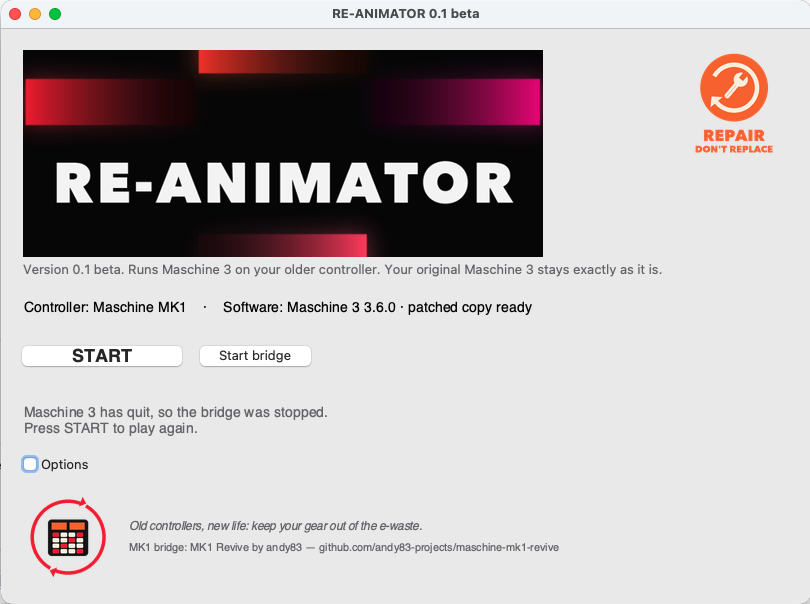

# RE-ANIMATOR

**Old controllers, new life.** RE-ANIMATOR runs **Maschine 3** on a **Maschine MK1**, a controller that Maschine 3
no longer supports on macOS. Keep your gear out of the e-waste.



> **Beta (0.1).** Unofficial; not made, supported or endorsed by Native Instruments. Use at your own risk.

## In plain words

**What it does.** Maschine 3 still has the MK1 support built in; Native Instruments switched it off. RE-ANIMATOR:

1. **makes a copy** of Maschine 3 and switches the MK1 support back on in that copy (two small changes);
2. **starts a small helper** (MK1 Revive by andy83) that talks to the MK1 over USB: Maschine's screens on the MK1, and
   the pads, buttons and knobs back to Maschine;
3. **opens the copy.** When you quit Maschine, the helper stops too.

**Why it is safe.**

* **Your original Maschine 3 is never touched.** It is only read; everything happens in the copy.
* **Your MK1 is not changed.** No firmware is written; it is only controlled over USB, just like NI's own software
  does.
* **It refuses instead of guessing.** If your Maschine version doesn't look exactly as expected, nothing is changed.
* **Fully undoable.** *Clean* deletes the copy; delete the app and everything is as before.
* **Open:** all the code is here to read.

## How it works

* It makes a **patched copy** of your installed Maschine 3 in its own folder (by default `~/Applications/RE-ANIMATOR`).
  Your **original Maschine 3 is only read and stays exactly as it is**. The copy switches on Maschine 3's own MK1
  support, which is still in the program but no longer used on macOS.
* It starts the **MK1 bridge** (MK1 Revive by andy83, included), which stands in for NI's hardware agent and drives the
  MK1: its displays, LEDs, pads, buttons and knobs.
* When you quit Maschine 3, the bridge stops by itself.

Nothing from Native Instruments is in this repository or in the app: RE-ANIMATOR patches *your* installation, on your
Mac.

## Requirements

* A Mac with **Apple Silicon** (M1 or later).
* **Maschine 3**, installed and activated (tested: 3.6.0). Other versions are checked before anything is patched: if
  RE-ANIMATOR does not find exactly what it expects, it refuses and changes nothing.
* A **Maschine MK1** connected over USB.
* About 1 GB of free disk space for the patched copy.

## Install (beta testers)

1. Download `RE-ANIMATOR-0.1-beta-arm64.zip` from the [Releases](../../releases) page and unzip it.
2. Move **RE-ANIMATOR.app** to your Applications folder.
3. First start: **right-click → Open → Open** (the app is not notarized by Apple, so macOS asks once). If macOS still
   blocks it: *System Settings → Privacy & Security → Open Anyway*.

## Use

1. Connect the MK1.
2. Open RE-ANIMATOR. The main screen shows the controller and the Maschine 3 version it found.
3. Press **START**. The first time it makes the patched copy (about a minute); then it starts the bridge and the copy.
4. Maschine 3 connects to the MK1 **after its plugin scan**, which can take a while with many plugins.
5. Quit Maschine 3 when you are done: the bridge stops by itself.

**Options** (folded away): choose Maschine 3, the folder for the copy, or the bridge by hand; **Clean** removes the
patched copies (only those: never your original or anything else).

## If something goes wrong

* **LCDs stay dark or frozen:** quit Maschine 3, press *Stop bridge*, unplug the MK1 and plug it back in, press START.
* **NI's own hardware agent** (NIHardwareAgent) holds the MK1 and its port: RE-ANIMATOR quits it on START and starts
  it again when you stop the bridge.
* **Logs** (please send them with a report):
  * `~/Library/Logs/RE-ANIMATOR-app.log` — what START and the watcher did
  * `~/Library/Logs/RE-ANIMATOR-bridge.log` and `/tmp/maschine-mk1-revive/*.log` — the bridge
* Report: open an issue with your macOS version, your Maschine 3 version, what you did, what happened, and the logs.

## Remove

Open Options → **Clean** (removes the patched copy), quit, and delete RE-ANIMATOR.app. Your original Maschine 3 was never
changed.

## Build from source

```sh
brew install libusb        # bundled into the app (LGPL-2.1, licence included)
./build.sh                 # -> dist/RE-ANIMATOR.app and dist/RE-ANIMATOR-<version>-arm64.zip
```

Source: `reanimator/` — `reanimator_app.py` (the window), `patch_maschine3_macos.py` (the patcher: finds every patch
point by symbol name, refuses if anything is ambiguous; also usable on its own, see `--help`), `bridge.py` (starting
and stopping the bridge), `mk1usb.py` (the one MK1 access RE-ANIMATOR makes itself: the LCD backlight).

## Credits

* **MK1 bridge: MK1 Revive by andy83** — <https://github.com/andy83-projects/maschine-mk1-revive>. Included with the
  author's permission (`docs/licenses/MK1-Revive.md`).
* **libusb** (LGPL-2.1) — <https://libusb.info>.
* Artwork: our own (`docs/licenses/artwork.md`).

Maschine and Native Instruments are trademarks of Native Instruments GmbH. RE-ANIMATOR is not affiliated with them.
